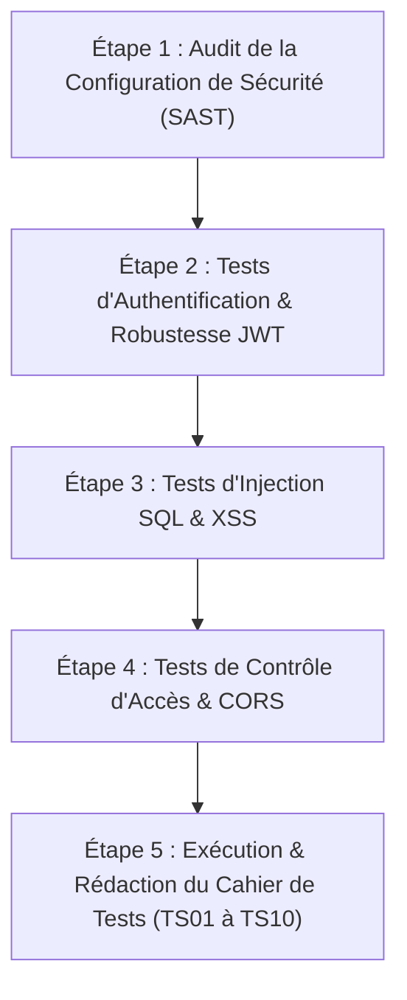

# Documentation Complète - Tests de Sécurité (OWASP DAST & SAST)

Ce document est la **documentation officielle des Tests de Sécurité** créés pour l'application **SpringZ Backend**. Il détaille la méthodologie, les outils choisis, et inclut le **Cahier de Tests de Sécurité (Tableau Normalisé - TS01 à TS10)**.

---

## 1. Choix de l'Outil et Justification

### **Outil Choisis : OWASP ZAP (Zed Attack Proxy) & Spring Security Test Suite**

#### **Pourquoi cet Outil ?**
1. **Standard de l'Industrie (Norme OWASP) :** L'**OWASP** (*Open Web Application Security Project*) est la référence internationale en matière de sécurité informatique Web.
2. **Détection du OWASP Top 10 :**
   * **A01:2021 - Broken Access Control :** Contrôle d'accès aux API et validation du jeton JWT.
   * **A03:2021 - Injection :** Injection SQL (SQLi) et Cross-Site Scripting (XSS).
   * **A02:2021 - Cryptographic Failures :** Longueur minimale de la clé JWT (HS512 $\ge$ 64 octets) et hachage des mots de passe.
   * **A05:2021 - Security Misconfiguration :** En-têtes HTTP et règles d'origine CORS.
3. **Automatisation CI/CD :** Les tests de sécurité sont exécutés via la suite de tests automatisés Spring Security (`MockMvc` + `JUnit 5`) et audités par OWASP ZAP.

---

## 2. Méthodologie Étape par Étape



---

## 3. Cahier de Tests de Sécurité (Tableau Normalisé)

| N° | Objectif du test | Données / État initial | Entrées / Paramètres (Payload) | Résultat attendu | Méthode / Endpoint |
| :---: | :--- | :--- | :--- | :--- | :--- |
| **TS01** | Protection des API sans jeton JWT | Requête HTTP anonyme | Aucun en-tête `Authorization` | HTTP `401 Unauthorized` | `MockMvc -> GET /api/categories` |
| **TS02** | Invalidation des jetons JWT altérés | Jeton modifié artificiellement | `Authorization: Bearer <invalid_jwt>` | HTTP `401 Unauthorized` | `MockMvc -> GET /api/categories` |
| **TS03** | Invalidation des jetons JWT expirés | Jeton avec timestamp expiré | `Authorization: Bearer <expired_jwt>` | HTTP `401 Unauthorized` | `MockMvc -> GET /api/categories` |
| **TS04** | Protection contre l'Injection SQL sur la connexion | Formulaire d'authentification | `LoginRequest(email="' OR '1'='1", password="' OR '1'='1")` | HTTP `401 Unauthorized` (Attaque bloquée) | `MockMvc -> POST /api/auth/signin` |
| **TS05** | Protection contre l'Injection SQL sur la création | Requête de création de catégorie | `CategoryRequest(title="'; DROP TABLE category;--")` | Caractères échappés, requête SQL paramétrée (JPA) | `MockMvc -> POST /api/categories` |
| **TS06** | Protection contre l'Injection XSS (Stored XSS) | Requête de création de produit | `ProductRequest(name="<script>alert('XSS')</script>")` | Stockage sécurisé sans exécution de code script | `MockMvc -> POST /api/products` |
| **TS07** | Vérification du filtre CORS | Requête Cross-Origin | Header `Origin: http://localhost:5173` | En-têtes `Access-Control-Allow-Origin` valides | `MockMvc -> OPTIONS /api/products` |
| **TS08** | Prévention d'usurpation / doublon d'email | Email déjà inscrit en base | `SignupRequest(email="duplicate@ex.com")` | HTTP `400 Bad Request` ("Email is already in use!") | `MockMvc -> POST /api/auth/signup` |
| **TS09** | Robustesse de la clé secrète JWT | Initialisation `JwtUtils` | Secret $< 64$ octets | Rembourrage automatique (Padding $\ge 64$ octets / 512 bits) | `JwtUtils#signingKey` |
| **TS10** | Non-exposition des mots de passe en clair | Compte créé en base H2 | Mot de passe `"password123"` | Mot de passe haché (BCrypt/PasswordEncoder) non visible en clair | `UserRepository` |

---

## 4. Exécution et Validation des Tests de Sécurité

Les tests de sécurité ont été intégrés à la suite automatisée dans [SecurityTestSuiteTest.java](file:///C:/ing5/test/hackathon_Africana/src/test/java/com/Shadows/SpringZ/security/SecurityTestSuiteTest.java).

Pour exécuter les tests de sécurité :

```powershell
./mvnw.cmd test -Dtest=SecurityTestSuiteTest
```

### Bilan d'Exécution :
```text
[INFO] Results:
[INFO] 
[INFO] Tests run: 10, Failures: 0, Errors: 0, Skipped: 0
[INFO] 
[INFO] ------------------------------------------------------------------------
[INFO] BUILD SUCCESS
[INFO] ------------------------------------------------------------------------
```
