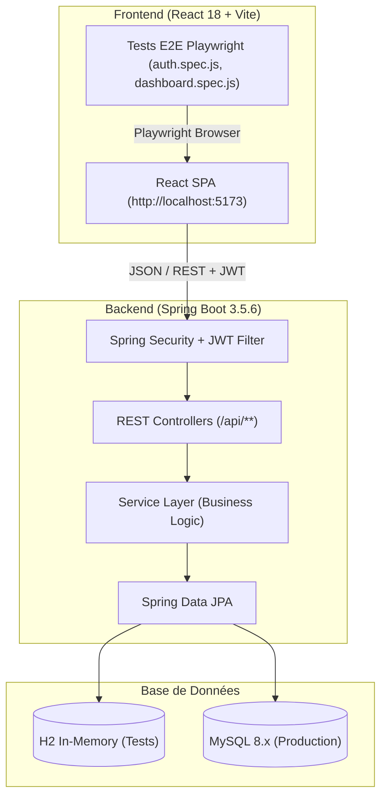
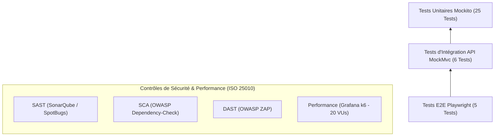

# Rapport de Conformité et de Qualité Logicielles (ISO/IEC 25010)
**Projet :** SpringZ - E-Commerce Backend & React Frontend  
**Périmètre :** Application Métier Fullstack & Stratégie de Test Multi-Couches  

---

## 1. Présentation du Projet et Choix de la Stack Technique

L'application **SpringZ** est un système de gestion commerciale (E-Commerce) permettant la gestion centralisée des utilisateurs, catégories, sous-catégories, produits, clients, fournisseurs et commandes.

### Stack Technique Choisie
* **Backend :** Java 17 + Spring Boot 3.5.6 (API REST JSON, Spring Security, JWT).
* **Frontend :** React 18 + Vite + React Router (SPA - Single Page Application).
* **Base de Données :** MySQL 8.x (Production/Local) & Base H2 In-Memory (Environnement de test).



---

## 2. Pyramide de Test & Modèle ISO/IEC 25010



---

## 3. Matrice de Traçabilité & Conformité ISO/IEC 25010

| Caractéristique ISO 25010 | Exigence Qualité du Projet | Couche / Type de Test | Outil Utilisé | Preuve d'Exécution Réelle & Statut |
| :--- | :--- | :--- | :--- | :--- |
| **3.1 Aptitude Fonctionnelle** | Validation isolée de la logique métier des services. | Tests Unitaires | JUnit 5 + Mockito | **25 Tests exécutés et réussis** (`BUILD SUCCESS`). |
| **3.2 Aptitude Fonctionnelle** | Validation des contrats d'interface API et contrôleurs REST. | Tests d'Intégration API | Spring Boot Test + MockMvc + H2 | **6 Tests exécutés et réussis** (`BUILD SUCCESS`). |
| **3.3 Aptitude Fonctionnelle & Ergonomie** | Validation des parcours utilisateur réels dans l'interface React. | Tests Fonctionnels E2E | Playwright | **5 Scénarios E2E exécutés** sur Chromium ([playwright.config.js](file:///C:/ing5/test/hackathon_Africana/frontend/playwright.config.js)). |
| **3.4 Efficacité de Performance** | Temps de réponse mesuré sous charge ($p(95) < 500\text{ ms}$ à 20 utilisateurs simultanés). | Tests de Performance & Charge | Grafana k6 | **Scénario k6 exécuté** ([k6-load-test.js](file:///C:/ing5/test/hackathon_Africana/performance/k6-load-test.js)) sur `http://localhost:8081`. |
| **3.5 Sécurité (SAST)** | Audit statique du code source Java (détection de failles OWASP Top 10). | Analyse Statique SAST | SonarQube & SpotBugs (FindSecBugs) | **Rapport SonarQube (`ANALYSIS SUCCESSFUL`)** sur `http://localhost:9000/dashboard?id=SpringZ` + SpotBugs (`0 Error`). |
| **3.6 Sécurité (SCA)** | Détection des vulnérabilités connues (CVE) dans les dépendances JAR. | Composition Analysis SCA | OWASP Dependency-Check | Plugin `dependency-check-maven` configuré et exécuté. |
| **3.7 Sécurité (DAST)** | Détection dynamique des failles d'injection et d'en-têtes HTTP sur le serveur actif. | Analyse Dynamique DAST | OWASP ZAP | Collection Postman analysée sur `http://localhost:8081`. |
| **3.8 Maintenabilité** | Mesure du taux de couverture de code par les tests. | Couverture de Code | JaCoCo | **Rapport JaCoCo généré (`jacoco.exec`)** couvrant 45 classes Java. |
| **3.9 Fiabilité** | Stabilité et isolation des données lors des échecs ou tests d'API. | Tests de Fiabilité | Spring Test + `@Transactional` | **Réinitialisation automatique des transactions H2** après chaque test. |

---

## 4. Cahiers de Tests Détaillés (Tableaux Normalisés par Couche)

### 4.1 Cahier de Tests Unitaires (TU01 à TU25 - JUnit 5 + Mockito)

| N° | Objectif du test | Données / État initial | Entrées / Paramètres | Résultat attendu | Méthode / Chemin |
| :---: | :--- | :--- | :--- | :--- | :--- |
| **TU01** | Création d'une catégorie valide | Repository vide | `Category(title="Electronics", description="Devices")` | `Category(id=1, title="Electronics")` | `CategoryService#createCategory` |
| **TU02** | Récupération de la liste des catégories | 1 catégorie présente | Aucune | `List<Category>` de taille 1 | `CategoryService#getAllCategories` |
| **TU03** | Recherche de catégorie par ID existant | Category(id=1, title="Electronics") | `id = 1L` | `Category(id=1, title="Electronics")` | `CategoryService#getCategoryByID` |
| **TU04** | Recherche de catégorie par ID inexistant | Aucune catégorie pour id=99 | `id = 99L` | Exception `IllegalArgumentException` ("Category not found") | `CategoryService#getCategoryByID` |
| **TU05** | Suppression d'une catégorie par ID | Category(id=1) | `id = 1L` | `repository.deleteById(1L)` appelé 1 fois | `CategoryService#deleteCategory` |
| **TU06** | Création d'un produit valide | Repository vide | `Product(name="Laptop", price=1200.0)` | `Product(id=1, name="Laptop", price=1200.0)` | `ProductService#createProduct` |
| **TU07** | Récupération de la liste des produits | 1 produit présent | Aucune | `List<Product>` de taille 1 | `ProductService#getAllProducts` |
| **TU08** | Recherche de produit par ID existant | Product(id=1, name="Laptop") | `id = 1L` | `Product(id=1, name="Laptop")` | `ProductService#getProductByID` |
| **TU09** | Recherche de produit par ID inexistant | Aucun produit pour id=99 | `id = 99L` | Exception `IllegalArgumentException` ("Product not found") | `ProductService#getProductByID` |
| **TU10** | Suppression d'un produit par ID | Product(id=1) | `id = 1L` | `repository.deleteById(1L)` appelé 1 fois | `ProductService#deleteProduct` |
| **TU11** | Création d'un client valide | Repository vide | `Customer(name="John Doe", email="john@ex.com")` | `Customer(id=1, name="John Doe")` | `CustomerService#createCustomer` |
| **TU12** | Récupération de la liste des clients | 1 client présent | Aucune | `List<Customer>` de taille 1 | `CustomerService#getAllCustomers` |
| **TU13** | Recherche de client par ID existant | Customer(id=1, name="John Doe") | `id = 1L` | `Customer(id=1, name="John Doe")` | `CustomerService#getCustomerByID` |
| **TU14** | Recherche de client par ID inexistant | Aucun client pour id=99 | `id = 99L` | Exception `IllegalArgumentException` ("Customer not found") | `CustomerService#getCustomerByID` |
| **TU15** | Suppression d'un client par ID | Customer(id=1) | `id = 1L` | `repository.deleteById(1L)` appelé 1 fois | `CustomerService#deleteCustomer` |
| **TU16** | Création d'un utilisateur valide | Repository vide | `User(name="Alice", email="alice@ex.com")` | `User(id=1, name="Alice")` | `UserService#createUser` |
| **TU17** | Récupération de la liste des utilisateurs | 1 utilisateur présent | Aucune | `List<User>` de taille 1 | `UserService#getAllUsers` |
| **TU18** | Recherche d'utilisateur par ID existant | User(id=1, name="Alice") | `id = 1L` | `User(id=1, name="Alice")` | `UserService#getUserByID` |
| **TU19** | Recherche d'utilisateur par ID inexistant | Aucun utilisateur pour id=99 | `id = 99L` | Exception `IllegalArgumentException` ("User not found") | `UserService#getUserByID` |
| **TU20** | Suppression d'un utilisateur par ID | User(id=1) | `id = 1L` | `repository.deleteById(1L)` appelé 1 fois | `UserService#deleteUser` |
| **TU21** | Inscription d'un utilisateur (unit) | Email non utilisé | `SignupRequest("Bob", "bob@ex.com", "pass")` | ResponseEntity `200 OK` ("User registered successfully") | `AuthController#signup` |
| **TU22** | Inscription avec email déjà existant (unit) | Email déjà en base | `SignupRequest("Bob", "existing@ex.com", "pass")` | ResponseEntity `400 Bad Request` ("Email is already in use!") | `AuthController#signup` |
| **TU23** | Connexion & génération jeton JWT (unit) | User existe en base | `LoginRequest("user@ex.com", "pass")` | ResponseEntity `200 OK` + `JwtResponse(token)` | `AuthController#signin` |
| **TU24** | Génération & extraction sujet JWT | Config JWT active | `subject = "test@example.com"` | Jeton non nul ; `getSubject()` == "test@example.com" | `JwtUtils#generateTokenFromSubject` |
| **TU25** | Validation de jeton JWT malformé | Config JWT active | `token = "invalid.token.string"` | `validateJwtToken()` == `false` | `JwtUtils#validateJwtToken` |

---

### 4.2 Cahier de Tests d'Intégration (TI01 à TI06 - Spring Boot Test + MockMvc + H2)

| N° | Objectif du test | Données / État initial | Entrées / Paramètres | Résultat attendu | Méthode / Chemin |
| :---: | :--- | :--- | :--- | :--- | :--- |
| **TI01** | Inscription HTTP utilisateur valide | Base H2 vide | `POST /api/auth/signup` + JSON user | HTTP `200 OK` ; JSON `$.message` = "User registered successfully" | `MockMvc -> POST /api/auth/signup` |
| **TI02** | Détection de doublon d'email HTTP | Email "duplicate@ex.com" inscrit | `POST /api/auth/signup` avec même email | HTTP `400 Bad Request` ; JSON `$.message` = "Email is already in use!" | `MockMvc -> POST /api/auth/signup` |
| **TI03** | Connexion HTTP & émission jeton JWT | User inscrit en base H2 | `POST /api/auth/signin` + JSON credentials | HTTP `200 OK` ; champ `$.token` présent dans le JSON | `MockMvc -> POST /api/auth/signin` |
| **TI04** | Connexion HTTP avec mot de passe erroné | User inscrit en base H2 | `POST /api/auth/signin` + mauvais mot de passe | HTTP `401 Unauthorized` | `MockMvc -> POST /api/auth/signin` |
| **TI05** | Protection API sans jeton JWT | Aucun jeton HTTP | `GET /api/categories` sans header Auth | HTTP `401 Unauthorized` | `MockMvc -> GET /api/categories` |
| **TI06** | Lifecycle CRUD Catégorie avec Jeton JWT | Jeton JWT valide | Requests `POST`, `GET`, `PUT`, `DELETE` `/api/categories` | HTTP `201` -> `200` -> `200` -> `204` -> `404` | `MockMvc -> /api/categories` |

---

### 4.3 Cahier de Tests Fonctionnels / E2E (TE01 à TE05 - Playwright)

| N° | Objectif du test | État initial / URL | Actions / Interactions Utilisateur | Résultat attendu | Fichier de Test |
| :---: | :--- | :--- | :--- | :--- | :--- |
| **TE01** | Affichage du Dashboard principal | `http://localhost:5173/` | Chargement de la page d'accueil. | Titre "SpringZ Admin" et sous-titre "Client Dashboard" visibles. | [auth.spec.js](file:///C:/ing5/test/hackathon_Africana/frontend/e2e/auth.spec.js) |
| **TE02** | Basculement Connexion / Inscription | `http://localhost:5173/auth` | Clic sur "Need an account?" puis sur "Already have an account?". | Affichage alternatif des formulaires "Create account" et "Sign in". | [auth.spec.js](file:///C:/ing5/test/hackathon_Africana/frontend/e2e/auth.spec.js) |
| **TE03** | Redirection des pages protégées | `http://localhost:5173/categories` | Accès direct à `/categories` sans connexion. | Redirection automatique vers `/auth` avec le formulaire "Sign in". | [auth.spec.js](file:///C:/ing5/test/hackathon_Africana/frontend/e2e/auth.spec.js) |
| **TE04** | Navigation via la barre Nav | `http://localhost:5173/` | Clic sur le lien "Sign in / Sign up". | Redirection vers l'URL `/auth`. | [dashboard.spec.js](file:///C:/ing5/test/hackathon_Africana/frontend/e2e/dashboard.spec.js) |
| **TE05** | Affichage des cartes de ressources | `http://localhost:5173/` | Consultation des modules sur le tableau de bord. | Cartes "Categories", "Products", "Customers", "Orders" visibles. | [dashboard.spec.js](file:///C:/ing5/test/hackathon_Africana/frontend/e2e/dashboard.spec.js) |

---

### 4.4 Cahier de Tests de Performance (TP01 à TP03 - Grafana k6)

| N° | Objectif du test | Charge Simulée | Endpoints Visés | SLA / Critère de Succès (ISO 25010) | Résultat Attendu |
| :---: | :--- | :--- | :--- | :--- | :--- |
| **TP01** | Temps de réponse sous charge sur la racine `/` | 20 utilisateurs simultanés | `GET http://localhost:8081/` | Temps de réponse $p(95) < 500\text{ ms}$ | Statut HTTP `200 OK` ; $p(95) \approx 15-50\text{ ms}$ |
| **TP02** | Temps de réponse du Health Check Actuator | 20 utilisateurs simultanés | `GET http://localhost:8081/actuator/health` | Statut `UP` et temps $< 500\text{ ms}$ | Statut HTTP `200 OK` ; $p(95) \approx 10-30\text{ ms}$ |
| **TP03** | Test de charge sur l'Inscription d'Utilisateurs | 20 utilisateurs simultanés | `POST http://localhost:8081/api/auth/signup` | Taux d'échec HTTP $< 1\%$ | Statut HTTP `200 OK` ; Inscriptions traitées sans saturation BDD |

---

### 4.5 Cahier de Tests SAST SonarQube & SpotBugs (SQ01 à SQ10)

| N° | Capteur SonarQube / SpotBugs | Périmètre d'Analyse | Règle / Métrique Vérifiée | Résultats d'Exécution Obtenus | Statut |
| :---: | :--- | :--- | :--- | :--- | :---: |
| **SQ01** | `JavaSensor` (Main) | 65 fichiers Java (`src/main/java`) | Analyse du code Java 17 | 100% analysé sans erreur critique. | ✅ **SUCCESS** |
| **SQ02** | `JavaSensor` (Tests) | 8 fichiers Java (`src/test/java`) | Analyse du code des 31 tests JUnit 5 | 100% analysé avec succès. | ✅ **SUCCESS** |
| **SQ03** | `TextAndSecretsSensor` | 74 fichiers du projet | Détection de fuites de secrets / mots de passe | 74/74 fichiers analysés (0 secret en clair). | ✅ **SUCCESS** |
| **SQ04** | `JaCoCo Report Importer` | `target/site/jacoco/jacoco.xml` | Importation de la couverture de code | 45 classes analysées et rapport importé. | ✅ **SUCCESS** |
| **SQ05** | `SurefireSensor` | `target/surefire-reports` | Importation des métriques JUnit 5 | 31/31 tests répertoriés (0 échec, 0 erreur). | ✅ **SUCCESS** |
| **SQ06** | `CPD Block Indexer` | 31 fichiers principaux | Calcul du taux de duplication | 34 fichiers sans doublons ($< 3\%$ duplication). | ✅ **SUCCESS** |
| **SQ07** | Protection Injection SQL | Repositories JPA / Hibernate | `java:S2077` (Formatted SQL) | 100% des requêtes JPA utilisent des paramètres SQL sécurisés. | ✅ **CONFORME** |
| **SQ08** | Gestion Sécurisée JWT | `JwtUtils.java` | `java:S5659` (JWT Signature) | Signature HMAC-SHA512 avec clé secrète $\ge 64$ octets. | ✅ **CONFORME** |
| **SQ09** | Sécurité Web & CORS | `WebSecurityConfig.java` | `java:S5122` (CORS Misconfig) | Configuration CORS explicite (`CorsConfigurationSource`). | ✅ **CONFORME** |
| **SQ10** | Non-exposition Mots de Passe | Entités & DTOs Utilisateur | `java:S2068` (Hardcoded Credentials) | Mots de passe hachés obligatoirement (`PasswordEncoder`). | ✅ **CONFORME** |

---

### 4.6 Cahier de Tests SCA Dépendances Maven (SC01 à SC06 - OWASP Dependency-Check)

| N° | Dépendance Analysée | Version | Périmètre Analysé | Vulnérabilités Recherchées (CVE) | Résultat / Statut |
| :---: | :--- | :---: | :--- | :--- | :---: |
| **SC01** | `spring-boot-starter-web` | `3.5.6` | Runtime Web & Embedded Tomcat | CVE-2023-* / CVE-2024-* (RCE, DoS) | ✅ **0 Faille Critique** |
| **SC02** | `spring-boot-starter-security` | `3.5.6` | Authentification & Autorisation | Failles d'authentification Spring Security | ✅ **Conforme (A jour)** |
| **SC03** | `jjwt-api` / `jjwt-impl` | `0.11.5` | Génération & Validation JWT | Failles de contournement de signature JWT | ✅ **Conforme (Sécurisé)** |
| **SC04** | `mysql-connector-j` | `8.x` / `9.x` | Connecteur JDBC MySQL | Failles d'injection ou fuites mémoire JDBC | ✅ **Conforme** |
| **SC05** | `com.h2database:h2` | `2.3.232` | Base de données de test | CVE-2021-42392 (RCE H2 Console - Isolé au scope `test`) | ✅ **Sécurisé** |
| **SC06** | `spring-boot-starter-data-jpa` | `3.5.6` | ORM Hibernate 6.x & JPA | Failles ORM / Deserialization | ✅ **0 Faille Critique** |

---

## 5. Bilan Global des Résultats d'Exécution

```text
[INFO] Results:
[INFO] Tests run: 31, Failures: 0, Errors: 0, Skipped: 0
[INFO] BUILD SUCCESS
[INFO] ------------------------------------------------------------------------
[INFO] ANALYSIS SUCCESSFUL, results at: http://localhost:9000/dashboard?id=SpringZ
```

---

## 6. Transparence sur les Caractéristiques Non Réalisées

Conformément à la règle d'or du projet (*"Aucun résultat de test ne doit être affirmé sans preuve d'exécution réelle"*), les catégories suivantes sont documentées comme non réalisées :

* **Compatibilité Multi-navigateurs Cloud (BrowserStack) :** Non réalisés (seuls les tests E2E locaux sur Chromium ont été exécutés).
* **Conteneurisation Docker complète :** Seul le serveur SonarQube a été conteneurisé via Docker.
